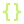

  

    

  
  
  
  

 

##  À propos

Développeur web indépendant et autodidacte. Je conçois des applications, des interfaces et des outils pensés pour être réellement utiles — du concept à la mise en production.

Je travaille principalement avec **JavaScript**, **TypeScript**, **React** et **Node.js**. J'apprends en construisant, et j'explore aussi **Python**, **Rust**, **C** et **C#** pour comprendre ce qui se passe sous le capot.

<table>
  <tr>
    <td>FOCUS</td>
    <td>Applications web · interfaces soignées · outils sur mesure</td>
  </tr>
  <tr>
    <td>MÉTHODE</td>
    <td>Comprendre le besoin, choisir la bonne stack, livrer quelque chose d'utile</td>
  </tr>
  <tr>
    <td>STATUT</td>
    <td>Ouvert aux collaborations et aux projets intéressants</td>
  </tr>
</table>

> Build with intent. Ship with care.

 

##  Ce que je construis

<table>
  <tr>
    <td align="center" width="33%">
        
      <b>Sites &amp; interfaces</b> 
      Vitrines, landing pages et expériences responsive.
    </td>
    <td align="center" width="33%">
        
      <b>Applications web</b> 
      Outils interactifs, tableaux de bord et interfaces métier.
    </td>
    <td align="center" width="33%">
        
      <b>Outils &amp; intégrations</b> 
      API, webhooks et automatisations sur mesure.
    </td>
  </tr>
</table>

 

##  Stack

  

 

##  Projets

  
    
  
    
  
    
  

  <a href="https://github.com/awashalt3-ux?tab=repositories"><b>Tous les dépôts →</b></a>

 

##  GitHub en chiffres

  

 

  
  

 

  

 

##  Contact

  
  
  

<code>Discord · kpasswd</code>

---

  Orpheus · 2026.
    
  
  

