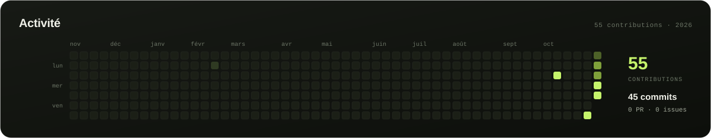
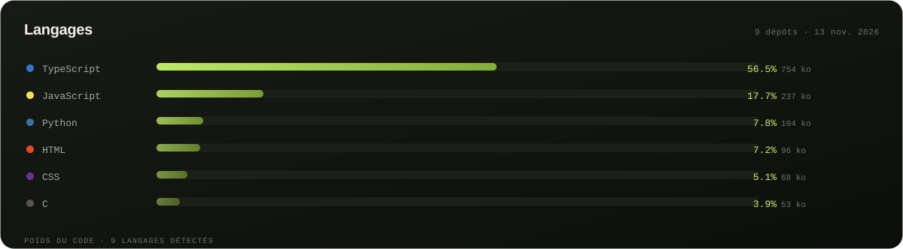

  

    

  
  
   
  
  

 

##  À propos

Développeur web indépendant et autodidacte. Je conçois des applications, des interfaces et des outils pensés pour être réellement utiles — du concept à la mise en production.

Ma conviction : **le logiciel est meilleur quand il reste près de l'utilisateur**. C'est pour cela que je construis en priorité des outils **local-first**, sans compte obligatoire et sans envoi de données vers un serveur. J'apprends en construisant, et j'explore aussi **Python**, **Rust**, **C** et **C#** pour comprendre ce qui se passe sous le capot.

<!-- STATS_ABOUT:START -->
57 contributions · 47 commits · 9 dépôts publics · 6 étoiles · langage principal TypeScript — année 2026.
<!-- STATS_ABOUT:END -->

<table>
  <tr>
    <td width="22%"><b>FOCUS</b></td>
    <td>Applications web · interfaces soignées · outils sur mesure</td>
  </tr>
  <tr>
    <td><b>MÉTHODE</b></td>
    <td>Comprendre le besoin, choisir la bonne stack, livrer quelque chose d'utile</td>
  </tr>
  <tr>
    <td><b>PRINCIPE</b></td>
    <td>Local-first par défaut, zéro dépendance quand c'est possible, aucune donnée qui traîne</td>
  </tr>
  <tr>
    <td><b>STATUT</b></td>
    <td>Ouvert aux collaborations et aux projets intéressants</td>
  </tr>
</table>

> *Build with intent. Ship with care.*

 

##  Ce que je construis

  

 

##  Stack

  <b>INTERFACE</b>

   

  
  
  
  
  
  
  

    

  <b>DONNÉES &amp; SERVEUR</b>

   

  
  
  
  
  
  

    

  <b>LANGAGES</b>

   

  
  
  
  
  

    

  <b>OUTILS</b>

   

  
  
  
  
  

 

##  Projets

 

  
  &nbsp;
  
    
  
  &nbsp;
  

  <a href="https://github.com/awashalt3-ux?tab=repositories"><b>Tous les dépôts →</b></a>

 

##  GitHub en chiffres

  

<!-- STATS_BADGES:START -->

  
  
  
  
  
  
  

Chiffres exacts — mise à jour le 14 nov. 2026.

<!-- STATS_BADGES:END -->

 

  

 

### Dépôts

<!-- STATS_REPOS:START -->
| Dépôt | Langage | Commits (an) | Étoiles | Dernière MAJ |
| :-- | :-- | --: | --: | --: |
| [**GoPSC**](https://github.com/awashalt3-ux/GoPSC) | Go | 1 | 0 | 12 nov. |
| [**chronos**](https://github.com/awashalt3-ux/chronos) | C | 1 | 0 | 12 nov. |
| [**port-scanner**](https://github.com/awashalt3-ux/port-scanner) | Python | 7 | 0 | 12 nov. |
| [**paperforge**](https://github.com/awashalt3-ux/paperforge) | TypeScript | 15 | 1 | 11 nov. |
| [**cipher**](https://github.com/awashalt3-ux/cipher) | JavaScript | 3 | 1 | 11 nov. |
| [**portfolio**](https://github.com/awashalt3-ux/portfolio) | HTML | 0 | 1 | 7 nov. |
| [**task-manager**](https://github.com/awashalt3-ux/task-manager) | Python | 1 | 1 | 7 nov. |
| [**webhook-manager**](https://github.com/awashalt3-ux/webhook-manager) | JavaScript | 1 | 1 | 7 nov. |
<!-- STATS_REPOS:END -->

 

  

 

##  Contact

Une idée, un projet, une question ? Le plus simple reste l'e-mail.

  
  
  

<code>Discord · kpasswd</code>

---

  Orpheus · 2026.
    
  
  

